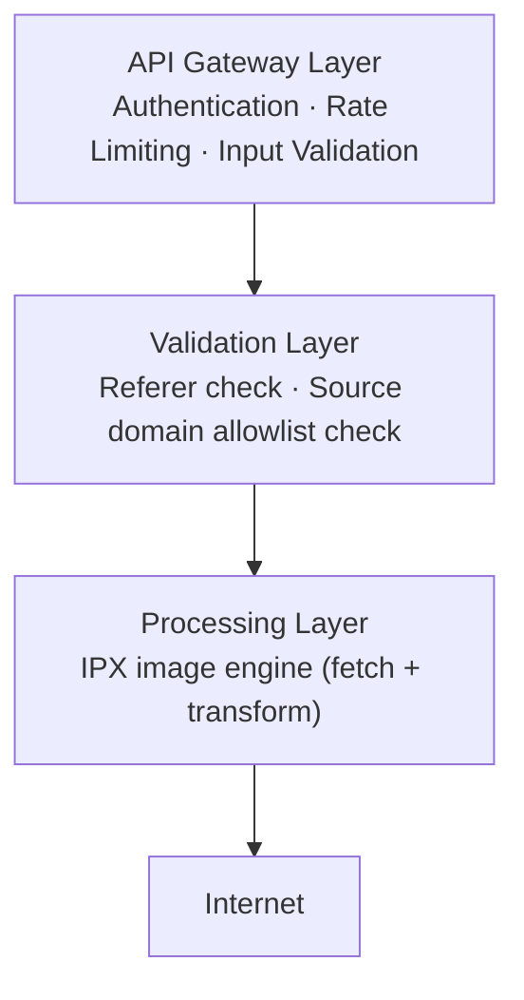
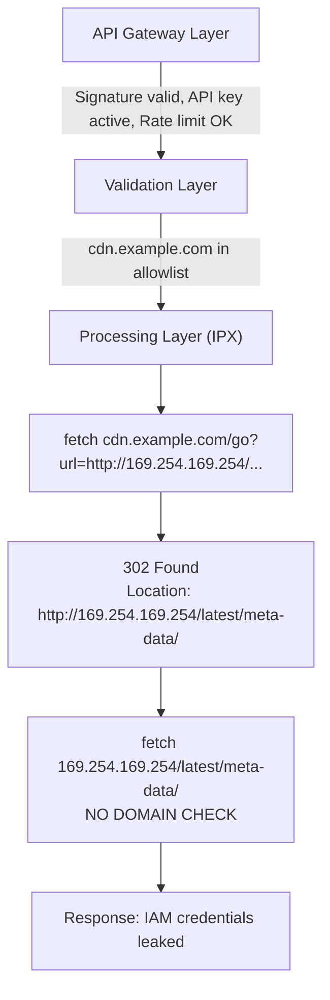
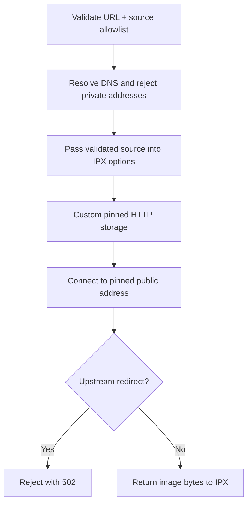

When you design a service that fetches external resources on behalf of users, you're building a proxy — whether you intend to or not. Every proxy is one misconfiguration away from being an open gateway into your private network. This article walks through the system design of a real image optimization API, shows how a seemingly correct architecture left a gap that enables Server-Side Request Forgery (SSRF), and explains the design principle we applied to close it.

---

## The System: An Image Optimization API

The service accepts a signed URL containing an image address and a set of transformation operations (resize, format conversion, etc.), fetches the original image from the internet, processes it, and returns the optimized result.

At a high level, the architecture has three layers:



The **API Gateway Layer** verifies the cryptographic signature, checks whether the API key is valid and not revoked, and enforces rate limits.

The **Validation Layer** ensures the requested image URL belongs to a domain on the project's allowlist (`allowedSourceDomains`). This is the security boundary — it decides which external hosts the server is willing to contact.

The **Processing Layer** is a third-party library (IPX) that receives a URL and a set of operations, fetches the image over HTTP, runs the transformations, and returns raw bytes.

This separation of concerns looks clean. Each layer has a single responsibility. But there is a critical design flaw hiding in the boundary between the Validation Layer and the Processing Layer.

---

## The Design Flaw to Avoid: Validation and Execution Operate on Different URLs

A common unsafe design is to validate the URL as the client submitted it, then hand the same string to a lower-level image library that performs its own network fetch:

```typescript
const sourceUrl = new URL(imageUrl);

if (!isAllowedSourceHost(sourceUrl.hostname, project.allowedSourceDomains)) {
  return error(403, "Source domain not allowed");
}

const ipx = getProjectIPX();
const result = await ipx(imageUrl, operations).process();
```

Here is the problem. The Validation Layer and the Processing Layer both receive the same input string — `imageUrl` — but the Processing Layer does not necessarily make a request to the host in that string. HTTP has a built-in mechanism for servers to say "the resource you want is actually over here": **redirects** (`301`, `302`, `307`, `308`). The Fetch API's default behavior is `redirect: "follow"`, meaning it silently follows the chain until it reaches a non-redirect response, and returns that.

So the two layers are actually operating on different things:

| Layer | What it sees |
|---|---|
| Validation Layer | The hostname in the **original URL** (`cdn.example.com`) |
| Processing Layer | The hostname in the **final URL after redirects** (could be anything) |

This is a **TOCTOU (Time-of-Check to Time-of-Use)** gap. The security check validates one value, but the system acts on a potentially different value.

---

## The Attack: Exploiting the Gap

An attacker who holds a valid API key for a project with `cdn.example.com` in its allowlist discovers an open redirect on that domain — say, `https://cdn.example.com/go?url=<target>`. They construct a signed request:

```text
GET /api/v1/my-project/w_800/cdn.example.com/go?url=http://169.254.169.254/latest/meta-data/
```

Here is what happens at each layer:



The server has just made an HTTP request to the cloud provider's instance metadata endpoint — an address that should never be reachable from user-controlled input. The attacker can use the same technique to reach any host visible from the server's network: internal microservices, databases with HTTP APIs, Kubernetes endpoints, or admin panels.

This class of vulnerability is called **SSRF (Server-Side Request Forgery)**. What makes this variant particularly subtle is that the initial URL *does* pass domain validation. The attacker doesn't need to sneak a malicious hostname past the check — they just need any redirect on an already-trusted domain.

---

## The Design Principle: Enforce Policy at the Point of Execution

The root cause is an architectural pattern that appears safe but isn't:

> **Anti-pattern:** Validate the input, then pass it to a component that transforms the input before acting on it.

The Validation Layer checked the URL. The Processing Layer then gave that URL to `fetch()`, which transparently transformed it (by following redirects) before making the actual network request. The validation was correct for the original input but meaningless for the transformed input.

The general principle:

> **Security invariants must be enforced at the point where the action is taken — not at an earlier stage whose output can be modified before execution.**

In a layered architecture, this means the component that makes the network call must either:

1. **Refuse to let the input change** — block redirects so the URL that was validated is the URL that is fetched, or
2. **Re-validate after the input changes** — follow redirects manually and re-run domain validation on each hop.

If you delegate the network call to a third-party library (as we do with IPX), you often can't inject custom validation into the library's internal fetch logic. That makes option 1 the only practical choice in most cases.

---

## The Fix: Validate, Pin, and Fetch Through a Guarded Storage Layer

OptStuff does not let IPX perform an unconstrained fetch from a raw user-controlled URL. The request route first validates the complete source URL:

```typescript
const sourceValidation = await validateSourceUrl(
  imageUrl,
  project.allowedSourceDomains,
);

if (!sourceValidation.ok) {
  return forbidden("Forbidden: Source domain not allowed");
}

const processedImage = await ipx(imageUrl, operations, {
  [VALIDATED_SOURCE_OPTION]: sourceValidation.source,
}).process();
```

`validateSourceUrl()` performs three checks before any upstream request is made:

1. The URL must use `http` or `https`.
2. The URL must match the project's `allowedSourceDomains`.
3. DNS results must resolve only to public addresses; localhost, private ranges, link-local ranges, documentation ranges, metadata hostnames, multicast, and other unsafe targets are rejected.

The validated URL and the validated DNS addresses are then passed into a custom IPX HTTP storage layer. That storage layer refuses to fetch unless the validated source object is present, verifies that the IPX storage ID still matches the validated URL, and then connects to the pinned validated address:

```typescript
const source = getValidatedSourceFromOptions(options);
assertStorageIdMatchesValidatedSource(id, source);

const response = await fetchPinnedUpstream(source, {
  method: "GET",
  signal: AbortSignal.timeout(10_000),
});
```

`fetchPinnedUpstream()` connects to the already-validated address, sets the original `Host` header, uses the original hostname for HTTPS SNI, and rejects any upstream redirect. This prevents both DNS rebinding and redirect-based SSRF bypasses.

After the fix, the system enforces a strict invariant: **the URL and public address that pass source validation are the URL and address the server contacts**. No later component can silently resolve a different destination.



---

## Alternative Design: Re-Validate on Redirect

If the system needed to support legitimate redirects (for example, CDNs that use `302` for geographic load balancing), the alternative would be manual redirect handling with re-validation on every hop:

```text
fetch(url, { redirect: "manual" })
  → if 3xx:
      extract Location header
      validate new URL against allowlist
      resolve DNS and reject private addresses
      if allowed: fetch(new_url, { redirect: "manual" })  ← repeat (up to N hops)
      if not allowed: reject
  → if 200: return response
```

This is more complex and introduces additional concerns:

- **Max hop limit** — without one, a redirect loop becomes a denial-of-service vector.
- **Relative URLs** — `Location` headers can be relative, requiring URL resolution.
- **Protocol downgrade** — a redirect from `https://` to `http://` could leak data in transit.
- **DNS rebinding per hop** — every redirect target must be resolved and pinned again.
- **Larger attack surface** — more code paths to test and audit.

OptStuff rejects redirects because image origins should serve assets directly, and the added complexity of manual redirect handling is not justified by the current use case. The simpler design is also the more secure one.

---

## Broader Lessons for System Design

### 1. Treat Every Server-Side Fetch as a Proxy

Any time your server makes an HTTP request to a URL derived from user input, you are building a proxy. Apply proxy-level security: validate the destination, resolve it safely, and make sure the component that performs the fetch cannot switch destinations later.

### 2. Third-Party Libraries Are Part of Your Trust Boundary

When you delegate a network call to a library, its default behavior becomes part of your security posture. OptStuff avoids relying on IPX's generic HTTP fetch path by giving IPX a custom storage layer that requires validated source metadata.

### 3. Defense in Depth Still Requires Correct Layering

Our system had multiple security layers (signatures, rate limits, domain allowlists), but they were all positioned *before* the processing step. None of them constrained *how* the processing step behaved. A layered defense is only effective if at least one layer is positioned at or after the point of execution.

### 4. Prefer Eliminating Behavior Over Detecting Abuse

We could have tried to detect SSRF attempts by inspecting redirect targets or analyzing response content. Instead, OptStuff reduces capability: source hosts must resolve to public addresses, those addresses are pinned for the fetch, and redirects are rejected. **Reducing capability is more reliable than detecting misuse.**

---

## Related Docs

- [Architecture Overview](/architecture/overview)
- [Request Lifecycle](/architecture/request-lifecycle)
- [Security Best Practices](/guides/security-best-practices)
